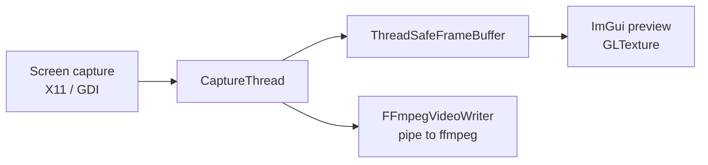

# NanoRec-CPP

A C++20 screen recorder for Linux (X11) and Windows (GDI) with a Dear ImGui control panel. Frames are captured on a worker thread and piped to the FFmpeg CLI for encoding. Work in progress.

[](https://github.com/bigalex95/NanoRec-CPP/actions/workflows/build-linux.yml)
[](https://github.com/bigalex95/NanoRec-CPP/actions/workflows/build-windows.yml)


<!-- TODO: demo GIF -->

## Features (implemented)

- Screen capture: X11 + XRandR on Linux, GDI on Windows, behind an `IScreenCapture` interface and a factory; multi-monitor enumeration.
- Capture on a dedicated thread, handing frames over through a thread-safe frame buffer.
- Video encoding by piping raw RGB frames to the `ffmpeg` executable (default `libx264`, 1080p, 60 fps config values in `Config`).
- Screenshot saving via stb_image_write.
- ImGui + OpenGL (GLFW) UI: Start/Stop Recording, Take Screenshot, live preview toggle.

## How it works



More detail: [docs/ARCHITECTURE.md](docs/ARCHITECTURE.md), [docs/SCREEN_CAPTURE.md](docs/SCREEN_CAPTURE.md), [docs/DEVELOPER_GUIDE.md](docs/DEVELOPER_GUIDE.md).

## Tech stack

C++20, CMake (3.15+), GLFW 3.3.8 (fetched by CMake), Dear ImGui (git submodule), stb_image_write and miniaudio (vendored single headers), FFmpeg CLI at runtime.

## Build and run

Prerequisites:

- Linux: `sudo apt install build-essential cmake libx11-dev libxrandr-dev libxinerama-dev libxcursor-dev libxi-dev libgl1-mesa-dev ffmpeg`
- Windows: Visual Studio 2022 (C++ desktop workload), CMake, FFmpeg on `PATH` (see [docs/WINDOWS_BUILD.md](docs/WINDOWS_BUILD.md)).

```bash
git clone --recurse-submodules https://github.com/bigalex95/NanoRec-CPP.git
cd NanoRec-CPP
cmake -B build -DCMAKE_BUILD_TYPE=Release
cmake --build build -j
./build/bin/NanoRec-CPP
```

Helper scripts `scripts/build.sh`, `scripts/run.sh` and `scripts/build_and_run.sh` wrap the same steps. `BUILD_TESTS` (default ON) also builds `test_capture`, `test_recording`, `test_window` and `test_imgui_basic` into `build/bin/tests/`. These are manual demo programs that need a display, not automated tests; see [tests/README.md](tests/README.md).

## Project structure

```
include/      public headers (capture/, core/, ui/)
src/          capture backends, core (Application, CaptureThread, FFmpegVideoWriter, ...), ui
vendor/       imgui (submodule), stb, miniaudio
tests/        manual demo programs
docs/         architecture, developer guide, build notes, task list
scripts/      build / run helpers
.github/      workflows: build-linux, build-windows, release
```

## Status and roadmap

Prototype. Not yet done or measured:

- [ ] Audio capture (microphone/system) with miniaudio: the header is vendored and `Config` has audio fields, but no capture code exists.
- [ ] Local audio transcription and summarization with whisper.cpp (planned, no code yet).
- [ ] Hardware-accelerated encoding options.
- [ ] Performance measurements (CPU use, dropped frames) on low-end hardware. No such numbers exist yet.
- [ ] Automated tests with assertions (current tests are manual demos).
- [ ] Screenshot/GIF of the UI.

## License

MIT, see [LICENSE](LICENSE). Third-party: Dear ImGui (MIT), stb (public domain / MIT), miniaudio (public domain / MIT-0), GLFW (zlib).
